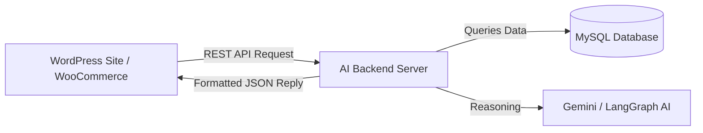
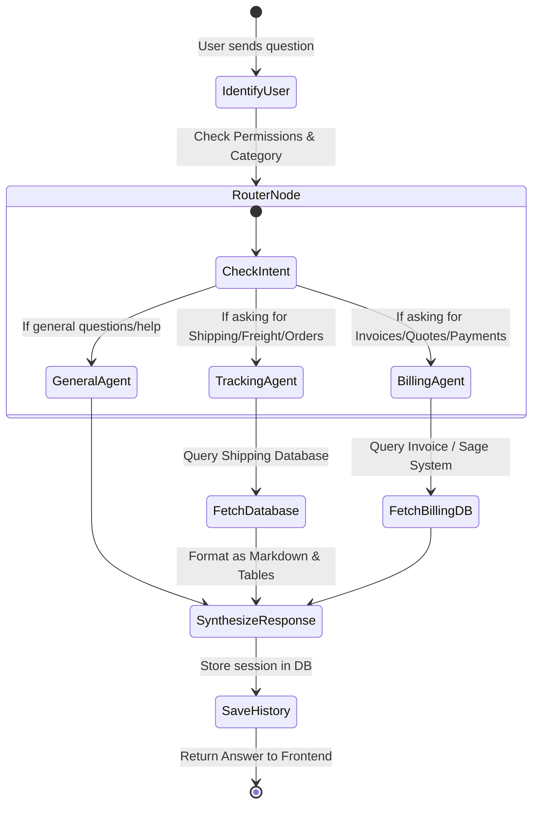

# AI Agent Implementation Guide & Standard Operating Procedure (SOP)
### Tailored for Web & WordPress Developers

---

## 1. Executive Summary: What is the AI Agent?

The **AI Agent** is an intelligent assistant that connects to your business database and answers user queries in real-time.

Instead of writing custom search queries for every user question, the AI:
1. **Understands Natural Language** (e.g., *"Where is my shipment?"*, *"Show pending invoices"*).
2. **Decides Which Action / Tool to Run** (e.g., Fetch Shipment from Database, Check User Permissions).
3. **Retrieves Real Data** and formats it into clean text, tables, and status cards.

---

## 2. Current Implementation in this Project

```text
[ WordPress / Web Frontend / React UI ]
                 │
                 │ 1. Sends User Question via REST API
                 ▼
     [ Node.js Backend API Server ]
                 │
                 ├──► 2. Checks User Role (Admin / Staff / Customer)
                 ├──► 3. Asks AI Model (Google Gemini)
                 │         │
                 │         └──► 4. AI calls Database Tools (Orders, Freights, Invoices)
                 │
                 ├──► 5. Saves Chat History in Database
                 │
                 ▼ 6. Returns Markdown Answer & Data Cards
[ WordPress / Web Frontend / React UI ]
```

### Key Components:
1. **API Endpoints**:
   - `POST /api/ai-chat/message`: Main chat endpoint (sends user question, returns reply).
   - `GET /api/ai-chat/history`: Retrieves previous chat messages for the logged-in user.
   - `POST /api/ai-chat/new-session`: Clears current conversation and starts a fresh one.
2. **Database Tools**:
   - Over 25 pre-built tools (Freight details, Warehouse status, Sage invoices, Quotes, Disputes, Staff directory).
3. **Security / Permissions**:
   - Customers only see **their own data**.
   - Staff only see **their assigned countries/accounts**.
   - Admins see **all company data**.

---

## 3. How to Connect this AI Agent to a WordPress Website

As a WordPress developer, you do not need to write backend AI code. You only connect WordPress to the AI backend via standard web methods:



### Implementation Options for WordPress:

### Option A: Embed Ready-Made Chat Widget (Easiest)
1. Add the floating chat bubble script or `<iframe>` in `footer.php` or using a Header/Footer plugin.
2. The widget sends the logged-in WordPress user ID:
   ```javascript
   // Pass current WordPress user ID to AI
   const currentUserId = wp_user_id; // from wp_localize_script
   ```

### Option B: WordPress Shortcode / Custom Plugin
1. Create a simple shortcode `[ai_chat_assistant]` in WordPress.
2. In your WordPress theme / plugin JavaScript:
   - Call `POST http://your-backend-api/api/ai-chat/message`
   - Pass `{ "user_id": currentUserId, "message": userInput }`
   - Display the response using standard Markdown rendering.

### Option C: WooCommerce / Portal Integration
- Place the AI search bar directly inside **My Account ➔ Orders / Shipments** tab.
- Users can type: *"Track order #1234"*, *"Download my last invoice"*, *"Contact my account manager"*.

---

## 4. LangChain & LangGraph: Concept & Implementation Guide

### What is LangChain & LangGraph in Simple Terms?

| Tool | What It Does (Analogy) |
| :--- | :--- |
| **LLM (Gemini / OpenAI)** | The **Brain** — Understands language and reasons about data. |
| **LangChain** | The **Toolbox** — Connects the brain to APIs, databases, documents, and webhooks. |
| **LangGraph** | The **Workflow Manager** — Controls multi-step decisions, conditional branches, loops, and human approvals. |

---

### Step-by-Step Implementation Flow with LangGraph



---

## 5. Step-by-Step Implementation Checklist for Developers

### Phase 1: Preparation & Setup
- [ ] **Get API Key**: Obtain a Google Gemini API Key from Google AI Studio.
- [ ] **Database Setup**: Run the chat history SQL schema (`ai/history/create-ai-chat-history.sql`).
- [ ] **Configure `.env`**: Set `GEMINI_API_KEY`, `GEMINI_MODEL`, and session timeout.

### Phase 2: Define Business Tools (What Can the AI Do?)
Define clear actions for the AI:
1. **Lookup Tool**: Find order or shipment by ID.
2. **List Tool**: Show all open orders for a specific customer.
3. **Summary / Status Tool**: Give quick status (e.g., In Transit, Delivered, Awaiting Customs).
4. **Action Tool**: Create support ticket, dispute, or quotation inquiry.

### Phase 3: Connect Frontend (WordPress / Web)
- [ ] Add the Chat UI to your website layout.
- [ ] Send authenticated user information (`user_id` or session token) with every request.
- [ ] Render the AI's Markdown response into styled cards, tables, and buttons.

### Phase 4: LangGraph Multi-Agent Scaling (When Growing)
- [ ] **Agent 1: Operations Agent** (Handles shipments, tracking, warehouse).
- [ ] **Agent 2: Finance Agent** (Handles invoices, payments, Sage sync).
- [ ] **Agent 3: Customer Care Agent** (Handles disputes, FAQs, contact info).
- [ ] **Supervisor**: Automatically sends user's prompt to the right specialized agent.

---

## 6. Best Practices for WordPress & Web Developers

1. **Never Expose API Keys on Frontend**:
   - Keep your Gemini / OpenAI keys on the backend server.
   - The WordPress frontend only talks to your secure backend API endpoint (`/api/ai-chat/message`).
2. **Enforce User Identity**:
   - Always pass the authenticated user's ID so customers never see another client's shipments or invoices.
3. **Handle Long Conversations**:
   - Use the built-in session timeout (TTL) so old chat sessions automatically reset after 1 hour of inactivity.
4. **Provide Quick Action Buttons**:
   - Show suggestion chips in your UI (e.g., `Track My Recent Order`, `Show Unpaid Invoices`, `Contact Support`) so users don't have to guess what to type.
