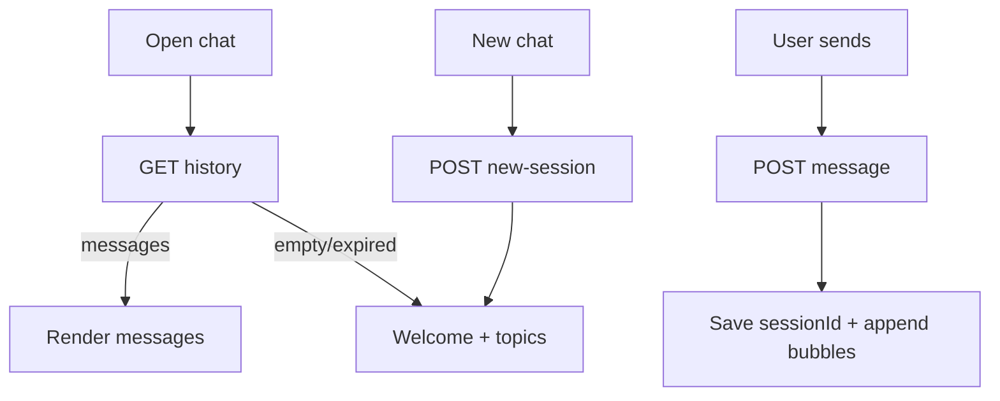

# Workspace AI — React Integration Guide

Use this when moving from the HTML demo to the real React Workspace app.

**Backend stays the same.** React only replaces the UI in [`ai/demo/ai-chat.html`](../demo/ai-chat.html).

| Item | Location |
|------|----------|
| Full HTML demo (copy UI/CSS/card renderers from here) | [`ai/demo/ai-chat.html`](../demo/ai-chat.html) |
| Open locally | `http://localhost:8080/ai-chat.html` |
| Backend module | `ai/` |
| Secrets | Project-root `.env` (never put keys in React) |

**No JWT.** Identify the user with `user_id` only (same as the HTML demo).

---

## 1. What React must call

Base URL = your API host (e.g. `https://api.example.com` or `http://localhost:8080`).

Pass the logged-in user's id as `user_id` on every call (query or JSON body). Do **not** send `Authorization` headers for AI chat.

### `GET /api/ai-chat/context?user_id={id}`

Returns user role + shortcut topics.

```json
{
  "success": true,
  "user": { "id": 1, "name": "…", "roleLabel": "Admin", "isAdmin": true },
  "topics": [{ "id": "freight", "title": "Freight status", "desc": "…", "needsInput": true, "prompt": "…" }]
}
```

### `GET /api/ai-chat/history?user_id={id}&session_id=`

- Omit `session_id` → latest **non-expired** session for that user.
- Empty / expired → `{ sessionId: null, messages: [] }` (show welcome).
- TTL default: **60 minutes of inactivity** (`AI_CHAT_HISTORY_TTL_MINUTES`).

```json
{
  "success": true,
  "sessionId": "u1-abc",
  "ttlMinutes": 60,
  "messages": [
    { "role": "user", "content": "hello", "data": null, "created_at": "…" },
    { "role": "assistant", "content": "Hi…", "data": { "freight": {} }, "provider": "rules" }
  ]
}
```

### `POST /api/ai-chat/new-session`

```json
{ "user_id": 1 }
```

Response: `{ "success": true, "sessionId": "u1-…", "ttlMinutes": 60 }`

### `POST /api/ai-chat/message`

```json
{
  "user_id": 1,
  "session_id": "u1-abc",
  "message": "Status of F-20260722005"
}
```

Response:

```json
{
  "success": true,
  "reply": "Markdown / text answer…",
  "data": { "freight": {}, "orders": [], "focusedAnswer": null },
  "sessionId": "u1-abc",
  "provider": "gemini"
}
```

`data` drives rich cards (same shapes the HTML demo already renders). If you skip cards at first, just show `reply`.

### `GET /api/ai-chat/status`

Optional health check (Gemini available / cooldown).

---

## 2. Product behaviour (match the HTML demo)

1. On open: load **history** for stored `sessionId` (or latest).
2. If messages exist → restore bubbles; else → welcome + shortcuts.
3. On send: POST message with `user_id` + `session_id`.
4. Save `sessionId` in `localStorage` key: `ai-chat-session:{userId}`.
5. **New chat** → `POST /new-session`, clear messages, show welcome.
6. After ~1 hour idle, history is gone server-side; clear local session and start fresh.



---

## 3. Suggested React files

```text
src/
  api/aiChat.js           # fetch wrappers
  hooks/useAiChat.js      # session + history + send
  components/ai/
    AiChatWidget.jsx      # floating panel shell
    MessageList.jsx
    MessageBubble.jsx
    Composer.jsx
    WelcomeCard.jsx
    # optional later: FreightCard.jsx, OrderCard.jsx, … (port from HTML)
```

---

## 4. API helper (`src/api/aiChat.js`)

```js
const API_BASE = process.env.REACT_APP_API_URL || '';

export async function getAiContext(userId) {
  const res = await fetch(
    `${API_BASE}/api/ai-chat/context?user_id=${encodeURIComponent(userId)}`
  );
  return res.json();
}

export async function getAiHistory(userId, sessionId) {
  let url = `${API_BASE}/api/ai-chat/history?user_id=${encodeURIComponent(userId)}`;
  if (sessionId) url += `&session_id=${encodeURIComponent(sessionId)}`;
  const res = await fetch(url);
  return res.json();
}

export async function createAiSession(userId) {
  const res = await fetch(`${API_BASE}/api/ai-chat/new-session`, {
    method: 'POST',
    headers: { 'Content-Type': 'application/json' },
    body: JSON.stringify({ user_id: Number(userId) }),
  });
  return res.json();
}

export async function sendAiMessage({ userId, sessionId, message }) {
  const res = await fetch(`${API_BASE}/api/ai-chat/message`, {
    method: 'POST',
    headers: { 'Content-Type': 'application/json' },
    body: JSON.stringify({
      user_id: Number(userId),
      session_id: sessionId,
      message,
    }),
  });
  return res.json();
}
```

---

## 5. Hook (`src/hooks/useAiChat.js`)

```js
import { useCallback, useEffect, useState } from 'react';
import {
  getAiContext,
  getAiHistory,
  createAiSession,
  sendAiMessage,
} from '../api/aiChat';

const sessionKey = (userId) => `ai-chat-session:${userId}`;

export function useAiChat({ userId }) {
  const [sessionId, setSessionId] = useState(() => {
    try {
      return localStorage.getItem(sessionKey(userId)) || null;
    } catch {
      return null;
    }
  });
  const [messages, setMessages] = useState([]);
  const [topics, setTopics] = useState([]);
  const [user, setUser] = useState(null);
  const [loading, setLoading] = useState(false);
  const [booting, setBooting] = useState(true);

  const persistSession = useCallback(
    (sid) => {
      setSessionId(sid || null);
      try {
        if (sid) localStorage.setItem(sessionKey(userId), sid);
        else localStorage.removeItem(sessionKey(userId));
      } catch {}
    },
    [userId]
  );

  useEffect(() => {
    let cancelled = false;
    async function boot() {
      if (!userId) return;
      setBooting(true);
      try {
        const ctx = await getAiContext(userId);
        if (!cancelled && ctx.success) {
          setUser(ctx.user);
          setTopics(ctx.topics || []);
        }

        let stored = null;
        try {
          stored = localStorage.getItem(sessionKey(userId));
        } catch {}

        const hist = await getAiHistory(userId, stored);
        if (cancelled) return;

        if (hist.success && hist.messages?.length) {
          persistSession(hist.sessionId);
          setMessages(
            hist.messages.map((m) => ({
              role: m.role,
              content: m.content,
              data: m.data || null,
            }))
          );
        } else {
          persistSession(null);
          setMessages([]);
        }
      } finally {
        if (!cancelled) setBooting(false);
      }
    }
    boot();
    return () => {
      cancelled = true;
    };
  }, [userId, persistSession]);

  const ensureSession = useCallback(async () => {
    if (sessionId) return sessionId;
    const hist = await getAiHistory(userId, null);
    if (hist.success && hist.sessionId) {
      persistSession(hist.sessionId);
      return hist.sessionId;
    }
    const created = await createAiSession(userId);
    if (created.success && created.sessionId) {
      persistSession(created.sessionId);
      return created.sessionId;
    }
    const fallback = `u${userId}-${Date.now().toString(36)}`;
    persistSession(fallback);
    return fallback;
  }, [sessionId, userId, persistSession]);

  const send = useCallback(
    async (text) => {
      const message = String(text || '').trim();
      if (!message || !userId) return;

      const sid = await ensureSession();
      setMessages((prev) => [...prev, { role: 'user', content: message }]);
      setLoading(true);
      try {
        const data = await sendAiMessage({ userId, sessionId: sid, message });
        if (!data.success) {
          setMessages((prev) => [
            ...prev,
            { role: 'system', content: data.message || 'Request failed' },
          ]);
          return;
        }
        if (data.sessionId) persistSession(data.sessionId);
        setMessages((prev) => [
          ...prev,
          { role: 'assistant', content: data.reply, data: data.data || null },
        ]);
      } catch (err) {
        setMessages((prev) => [
          ...prev,
          { role: 'system', content: err.message || 'Network error' },
        ]);
      } finally {
        setLoading(false);
      }
    },
    [userId, ensureSession, persistSession]
  );

  const newChat = useCallback(async () => {
    const data = await createAiSession(userId);
    if (data.success && data.sessionId) {
      persistSession(data.sessionId);
      setMessages([]);
    }
  }, [userId, persistSession]);

  return {
    user,
    topics,
    messages,
    loading,
    booting,
    sessionId,
    send,
    newChat,
  };
}
```

---

## 6. Minimal widget (`AiChatWidget.jsx`)

```jsx
import { useState } from 'react';
import { useAiChat } from '../../hooks/useAiChat';

export default function AiChatWidget({ userId }) {
  const { user, topics, messages, loading, booting, send, newChat } = useAiChat({
    userId,
  });
  const [open, setOpen] = useState(false);
  const [input, setInput] = useState('');

  if (!open) {
    return (
      <button type="button" className="ai-fab" onClick={() => setOpen(true)}>
        AI
      </button>
    );
  }

  return (
    <div className="ai-panel">
      <header>
        <div>
          <strong>Workspace AI</strong>
          <div>{user?.roleLabel}{user?.name ? `: ${user.name}` : ''}</div>
        </div>
        <button type="button" onClick={newChat}>New chat</button>
        <button type="button" onClick={() => setOpen(false)}>×</button>
      </header>

      <div className="ai-messages">
        {booting && <p>Loading…</p>}
        {!booting && messages.length === 0 && (
          <div className="welcome">
            <p>How can I help?</p>
            {topics.slice(0, 4).map((t) => (
              <button
                key={t.id}
                type="button"
                onClick={() => {
                  if (t.message) send(t.message);
                }}
              >
                {t.title}
              </button>
            ))}
          </div>
        )}
        {messages.map((m, i) => (
          <div key={i} className={`bubble ${m.role}`}>
            <div>{m.content}</div>
          </div>
        ))}
        {loading && <div className="bubble assistant">…</div>}
      </div>

      <footer>
        <input
          value={input}
          onChange={(e) => setInput(e.target.value)}
          onKeyDown={(e) => {
            if (e.key === 'Enter' && input.trim()) {
              send(input);
              setInput('');
            }
          }}
          placeholder="Ask about freights, orders, invoices…"
        />
        <button
          type="button"
          disabled={loading || !input.trim()}
          onClick={() => {
            send(input);
            setInput('');
          }}
        >
          Send
        </button>
      </footer>
    </div>
  );
}
```

```jsx
<AiChatWidget userId={authUser.id} />
```

---

## 7. Porting UI from the HTML demo

1. Shell — floating button + panel + header (New chat / close) + composer  
2. Text bubbles — user / assistant / system  
3. Welcome + topics from `/context`  
4. Cards later — port from `ai/demo/ai-chat.html` when `message.data` is present  

---

## 8. Env for React

```env
REACT_APP_API_URL=http://localhost:8080
```

Do **not** put `GEMINI_API_KEY` in React.

---

## 9. Checklist

- [ ] Call `/context` with `user_id`  
- [ ] Persist `sessionId` in `localStorage`  
- [ ] Restore via `/history` on mount  
- [ ] Send via `/message` with `user_id` + `session_id`  
- [ ] **New chat** via `/new-session`  
- [ ] No JWT / Authorization header for AI chat  
- [ ] Handle empty history after 1h inactivity  

---

## 10. Share with frontend

1. This file — `ai/docs/REACT_AI_CHAT.md`  
2. HTML demo — `ai/demo/ai-chat.html`  
3. API overview — `ai/docs/AI_CHAT.md`  
